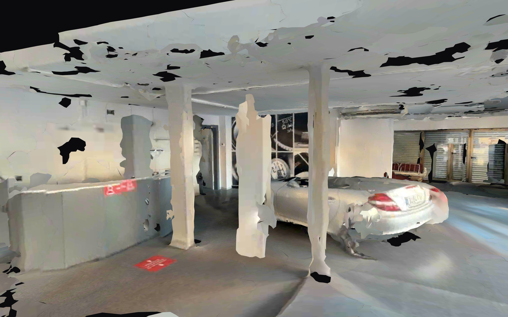
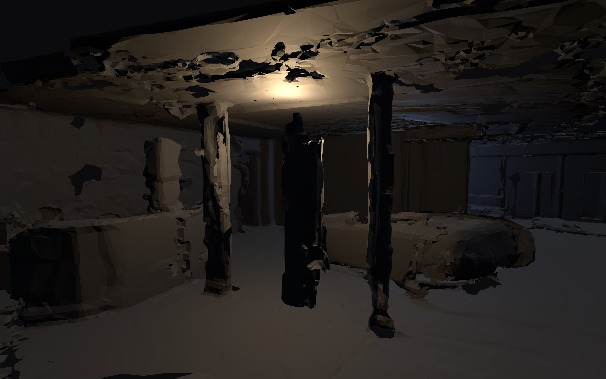
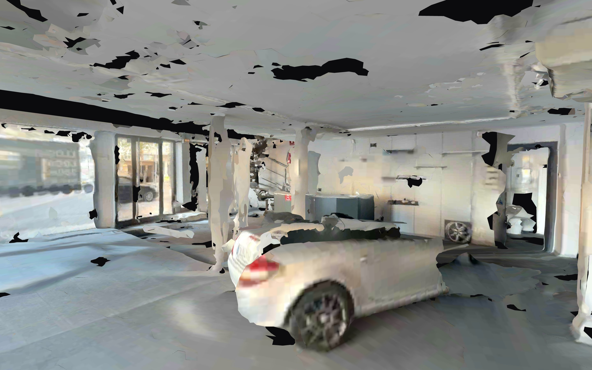
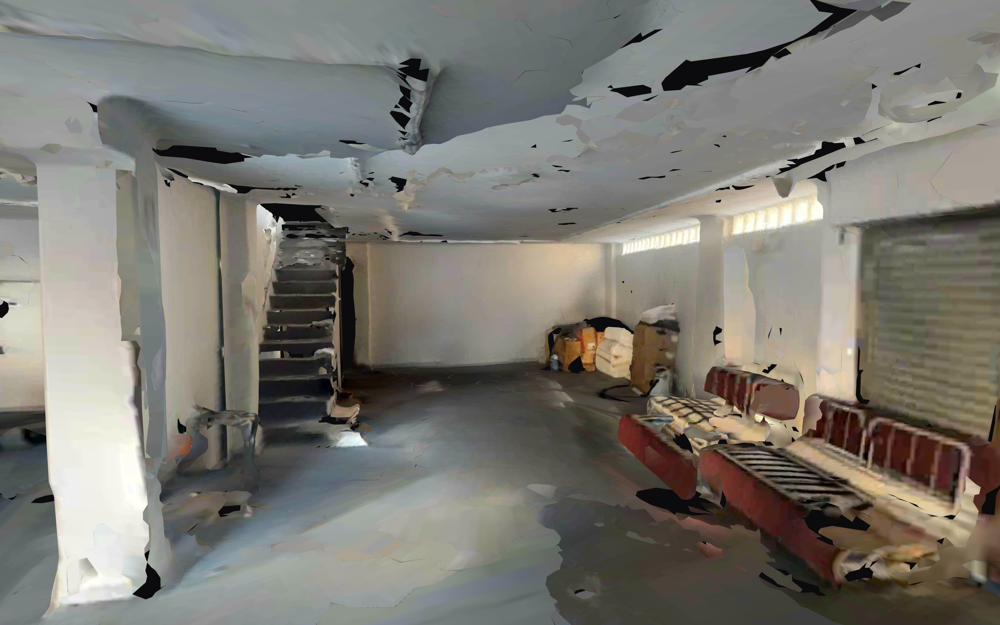
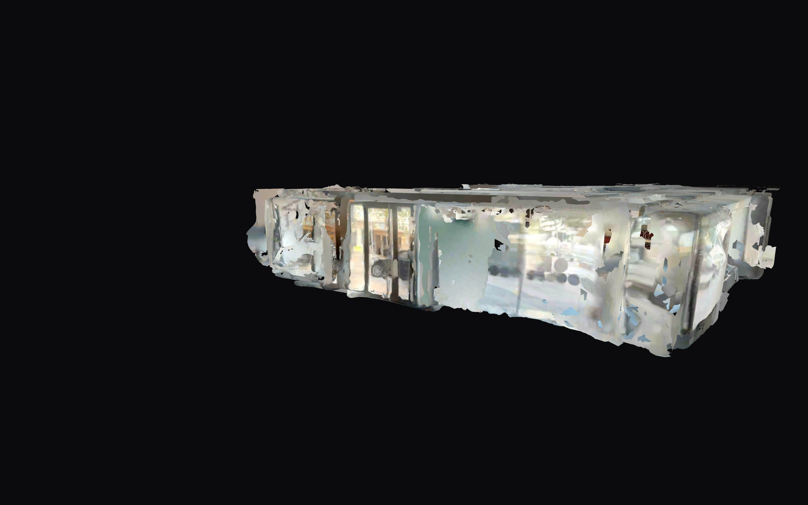
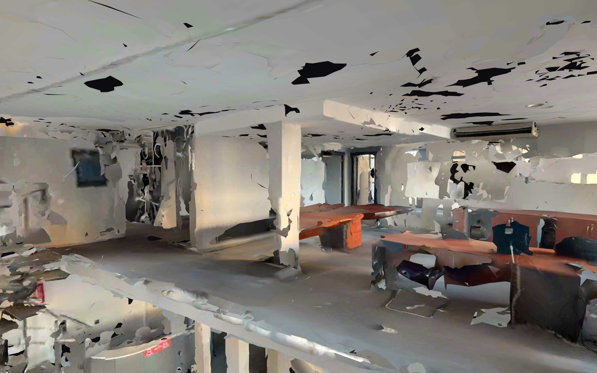
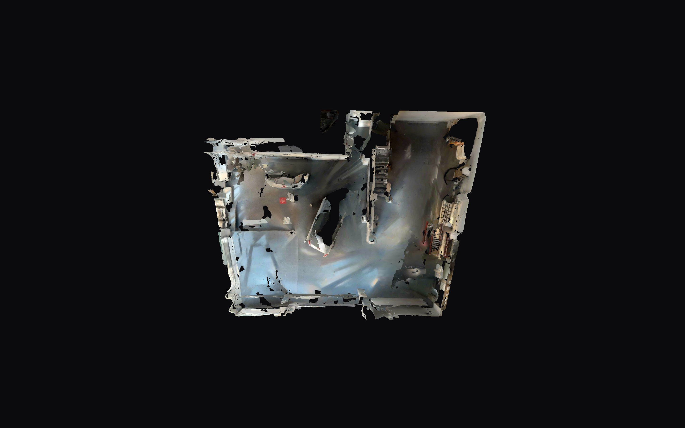
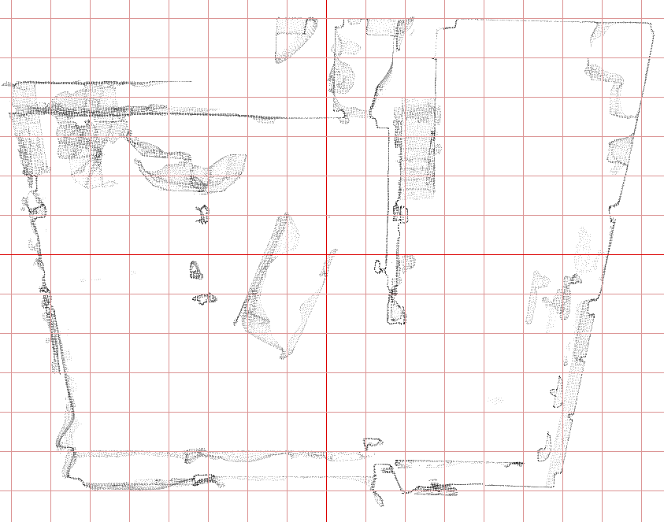
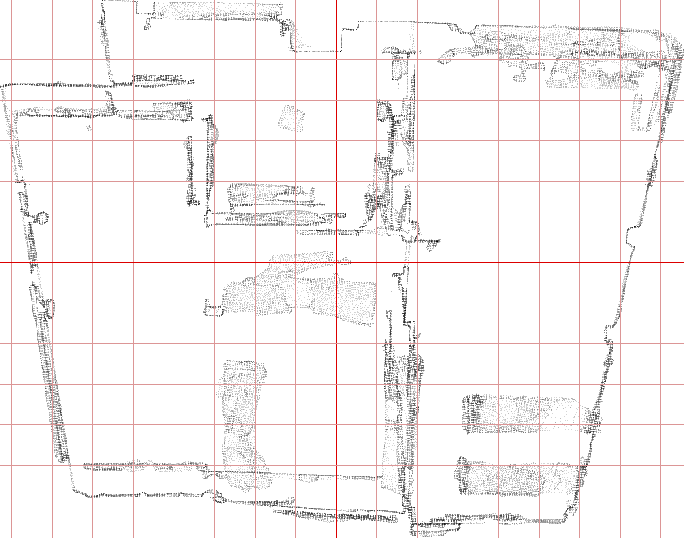

# Spike 3D · ¿sirve el escaneo LiDAR del local como base del hero?

**Fecha:** 21/10/2026 · **Fuente:** `/Users/carlos/totauto_intel/20_10_2026.glb` (Polycam, 45 MB) · **Rama:** `claude/kind-diffie-645544`

## Recomendación: GO con reservas (solo como malla sin texturas)

El escaneo **sirve como base geométrica** para una versión estilizada en oscuro del local: la escala es métrica, y conserva muros, pilares redondos, el tabique con la puerta, el mostrador curvo, la cristalera de la fachada y el forjado de la planta alta. **No sirve con sus texturas**: están desenfocadas, quemadas junto a la cristalera y llenas de agujeros en el techo; la escalera de caracol se reconstruye como un bloque informe.

Plan propuesto para el hero:

1. Usar `public/models/showroom-mesh.glb` (0,73 MB, 259 k triángulos; solo planta baja = 164 k) con materiales planos oscuros (`MeshStandardMaterial` con `flatShading`, o un material custom con rim light y niebla). Ocultar el nodo `planta_alta` en móvil.
2. Sustituir suelo y techo del escaneo por dos planos limpios (el techo escaneado es la peor parte: agujeros y ruido). Es trivial: cortar la malla con dos `clippingPlanes` a Y ≈ −1,50 y Y ≈ 0,90, o recortarla en el pipeline.
3. Modelar a mano tres elementos: la escalera de caracol (bloque en el escaneo), la cristalera (planos de vidrio con reflejo) y quitar el coche aparcado dentro (está escaneado en medio de la sala principal, X −2…0, Z 0…2,8).
4. Recorrido de cámara por scroll dentro de la planta baja: entrada por la fachada (esquina X −7,4 / Z +5,3), pasillo entre pilares hasta el tabique, giro hacia la sala trasera.

Si no se quiere invertir en los puntos 2–3, la alternativa es **NO-GO** y hacer el hero con vídeo/secuencia de imágenes: la malla cruda con texturas no da nivel de showroom.

## Versiones generadas (`public/models/`)

| Archivo | Tamaño | Triángulos (PB / PA) | Texturas | Extensiones | Uso |
|---|---|---|---|---|---|
| original `20_10_2026.glb` | 45,23 MB | 1.220.447 (534 k / 687 k) | 11 × JPEG 4096² (una 4096×3328), 19 MB | ninguna | fuente, no tocar |
| `showroom.glb` | **3,02 MB** | **258.666** (164.524 / 94.142) | 11 × KTX2 ETC1S 1024², 1,89 MB | Draco, KHR_texture_basisu, KHR_materials_unlit | móvil (≤ 5 MB, ≤ 300 k ✔) |
| `showroom-hq.glb` | **8,00 MB** | 564.668 (329.194 / 235.474) | 11 × KTX2 ETC1S 2048², 6,16 MB | Draco, basisu, unlit | escritorio (≤ 15 MB ✔) |
| `showroom-mesh.glb` | **0,73 MB** | 258.629 (164.477 / 94.152) | ninguna, sin UVs | Draco | **base estilizada (recomendada)** |

Las tres versiones llevan dos nodos raíz con nombre, `planta_baja` y `planta_alta`, para poder descartar la planta alta en móvil. Los materiales con textura son *unlit* (la iluminación ya está horneada en el escaneo). Carga+parse local en Chrome: 0,20 s (showroom), 0,24 s (hq), 0,04 s (mesh).

**Requisitos en three/R3F:** `DRACOLoader` (decoder de gstatic o `/draco/`) y `KTX2Loader` (transcoder basis en `examples/jsm/libs/basis/`). `showroom-mesh.glb` solo necesita Draco.

## Preview

`public/models/preview/index.html` (three.js r170 por ESM desde CDN, sin depender del proyecto Next). Botones para cada GLB, vistas predefinidas (sala principal, sala trasera, escalera, fachada, planta alta, cenital, exterior), toggles de planta alta, modo estilizado oscuro, wireframe y sección horizontal (corta el techo a la Y indicada).

```bash
npx serve public
```

y abrir `http://localhost:3000/models/preview/?m=showroom-mesh.glb&styl=1&pa=0`. Parámetros: `m` (archivo), `v` (vista), `styl=1`, `pa=0`, `cut=0.6`.

## Capturas

Textura original (showroom.glb, 1K) · sala principal desde la cristalera: mostrador, pilares, mural del tabique y el coche aparcado dentro. Techo con agujeros (negro).



Misma vista con `showroom-mesh.glb` en modo estilizado (material plano oscuro + luz puntual cálida). Los volúmenes se leen bien; el techo ruidoso es lo que hay que sustituir.



Sala principal desde el lado del tabique mirando a la fachada (coche en primer plano, cristalera al fondo).



Sala trasera (tras el tabique, X > 1,9 m): estanterías metálicas, cajas, techo con fluorescentes.



Fachada vista desde la calle (solo existe lo que el LiDAR vio a través del cristal: la calle, coches aparcados y el interior).



Planta alta (oficina con mesas) y planta baja en sección cenital (corte a Y = 0,6 m).




Más capturas en `docs/img/`: `mesh-*.jpg` (todas las vistas estilizadas, `mesh-escalera-wire.jpg` en wireframe para ver la decimación) y `hq-*.jpg` (comparativa 2K).

## Escala y medidas

Y es la vertical (glTF). Medidas tomadas con histogramas de vértices sobre el original (`tools/analyze.mjs`, `measure.mjs`, `measure2.mjs`), sin depender de ningún visor:

| Elemento | Medida en el escaneo | Esperado |
|---|---|---|
| Suelo planta baja → techo planta baja | Y −1,55 → Y +0,95 = **2,50 m** | ≈ 2,45 m |
| Suelo planta alta → techo planta alta | Y +1,30 → Y +3,75 = **2,45 m** | ≈ 2,45 m |
| Forjado entre plantas | 0,35 m | — |
| Tabique sala principal / trasera | caras en X ≈ 1,55 y 1,85 (≈ 30 cm de grueso), de Z −3,8 a Z +1,8 = **5,6 m** | ≈ 5,5 m |
| Caja total | 16,9 × 5,7 × 13,2 m | — |
| Sala principal (aprox.) | X −7,4…1,5 × Z −4,5…5,3 ≈ 9 × 10 m | PB ≈ 140 m² en total |
| Sala trasera (aprox.) | X 1,9…7,3 (5,4 m de ancho) | — |

Conclusión: **la escala es métrica** (error < 5 cm en las alturas). No hace falta reescalar.

Mapas de densidad en planta usados para las medidas (1 px = 2 cm, rejilla de 1 m; línea negra = ejes X=0 / Z=0; origen en X −8,29, Z −6,46):




## Problemas detectados

- **Texturas**: desenfocadas (típico Polycam), quemadas a blanco en todo lo que está cerca de la cristalera, y con costuras entre los 11 parches del atlas. A 2K mejoran poco porque la fuente ya es borrosa. Descartadas para el hero.
- **Agujeros**: el techo de ambas plantas tiene cientos de agujeros (zonas sin retorno LiDAR: luminarias, superficies blancas brillantes). El suelo pulido también tiene huecos y el cristal de la fachada no existe como superficie (se ve la calle a través).
- **Ruido**: 13 % de los triángulos originales (161 k) eran fragmentos flotantes de menos de 150 triángulos; se han eliminado por conectividad. Había además geometría por debajo del suelo (hasta Y −2,02) y fuera de la caja; eliminada. Blender no estaba instalado, así que todo el filtrado se hizo con `@gltf-transform` + un script propio.
- **Escalera de caracol**: los peldaños y la barandilla (elementos finos) se reconstruyen como un bloque blanco de suelo a techo junto al mostrador (X ≈ −1, Z ≈ −2). Hay que modelarla a mano.
- **Objetos**: hay un coche aparcado dentro de la sala principal, cajas y estanterías en la trasera, y mesas y sillas en la planta alta. Para el showroom hay que quitarlos o aceptarlos como "attrezzo".
- **Costuras**: el escaneo viene en 22 trozos (11 por planta, uno por textura); al decimar cada trozo por separado aparecen pequeñas grietas en las uniones. Con material opaco y luz baja no se notan; si se quisiera suavizar, habría que soldar entre trozos (`join` + `weld`) antes de decimar.

## Comandos exactos usados

Todo en el scratchpad, sin tocar `package.json`. Se usó `@gltf-transform/{core,functions,extensions,cli}@4.5`, `meshoptimizer`, `draco3dgltf`, `sharp` y el binario `ktx`/`toktx` de KTX-Software 4.4.2 (descargado del release oficial de KhronosGroup y expandido con `pkgutil --expand-full`, sin instalarlo en el sistema).

```bash
# 1. Inspección del original (no se modifica)
npx -y @gltf-transform/cli@4 inspect /Users/carlos/totauto_intel/20_10_2026.glb

# 2. Entorno de trabajo
mkdir -p spike && cd spike && npm init -y
npm i @gltf-transform/core@4 @gltf-transform/functions@4 @gltf-transform/extensions@4 @gltf-transform/cli@4 meshoptimizer draco3dgltf sharp
curl -sLo ktx.pkg https://github.com/KhronosGroup/KTX-Software/releases/download/v4.4.2/KTX-Software-4.4.2-Darwin-arm64.pkg
pkgutil --expand-full ktx.pkg ktx_expanded
mkdir -p ktxbin/bin ktxbin/lib
cp ktx_expanded/KTX-Software-4.4.2-Darwin-arm64-tools.pkg/Payload/usr/local/bin/{ktx,toktx} ktxbin/bin/
cp -a ktx_expanded/KTX-Software-4.4.2-Darwin-arm64-library.pkg/Payload/usr/local/lib/libktx* ktxbin/lib/
export PATH=$PWD/ktxbin/bin:$PATH

# 3. Limpieza (caja, bajo-suelo, componentes < 150 tris) + decimación meshopt por planta
#    (script en docs/tools/process.mjs; ratio-pb/ratio-pa = fracción de triángulos que se conserva)
node process.mjs --in 20_10_2026.glb --out showroom-geo.glb    --ratio-pb 0.35 --ratio-pa 0.16
node process.mjs --in 20_10_2026.glb --out showroom-hq-geo.glb --ratio-pb 0.70 --ratio-pa 0.40
node process.mjs --in 20_10_2026.glb --out mesh-geo.glb        --ratio-pb 0.35 --ratio-pa 0.16 --strip-textures

# 4. Texturas (resize → KTX2 ETC1S), unlit y Draco
G=node_modules/.bin/gltf-transform
$G resize showroom-geo.glb s1.glb --width 1024 --height 1024
$G etc1s  s1.glb s2.glb --quality 128
$G unlit  s2.glb s3.glb
$G draco  s3.glb public/models/showroom.glb

$G resize showroom-hq-geo.glb h1.glb --width 2048 --height 2048
$G etc1s  h1.glb h2.glb --quality 128
$G unlit  h2.glb h3.glb
$G draco  h3.glb public/models/showroom-hq.glb

$G draco  mesh-geo.glb public/models/showroom-mesh.glb

# 5. Preview
npx serve public   # → http://localhost:3000/models/preview/
```

Los scripts (`process.mjs`, `analyze.mjs`, `measure.mjs`, `measure2.mjs`, `stats.mjs`) están copiados en `docs/tools/` para poder repetir el proceso.
